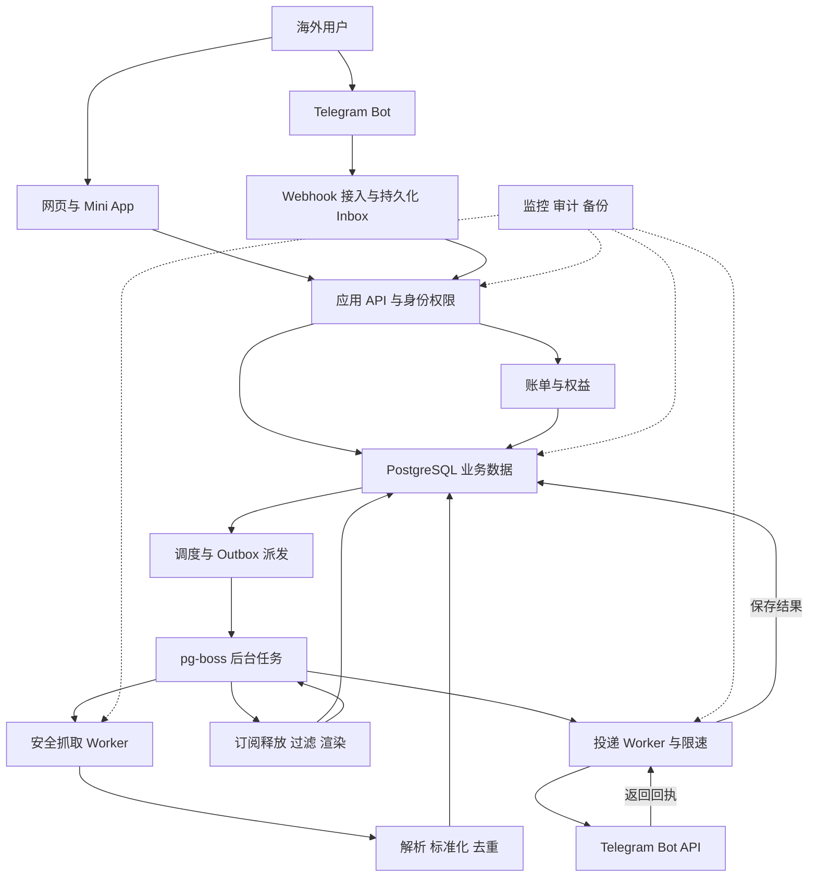
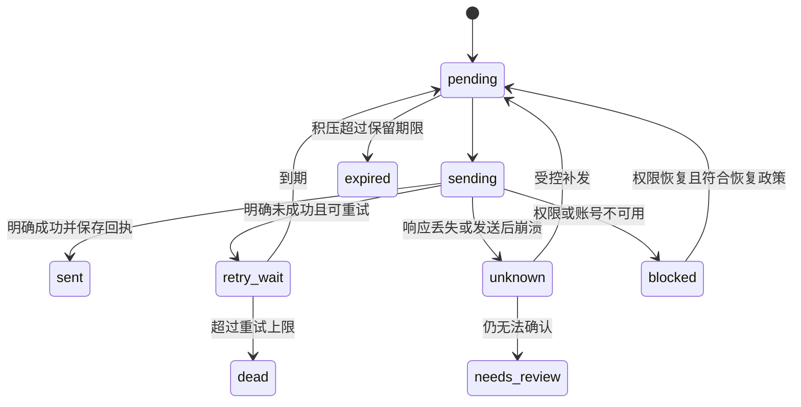

# Telegram RSS 更新推送机器人架构与模块设计

本文定义面向海外频道管理员的 RSS 更新推送服务，覆盖产品边界、10 个开发模块、数据与任务流、Telegram 授权和收费、部署恢复、实施顺序及验收。设计版本 1.0，资料核对日期为 2026 年 10 月 3 日。

核心方案是 TypeScript 模块化单体，配合 PostgreSQL 和 pg-boss 后台任务。网页与 Telegram 共用同一套业务逻辑；抓取和发送分进程运行。先实现公开 RSS／Atom 到获授权 Telegram 目标的可靠推送，再按真实需求接入 API 来源。本文是可交付开发的设计基线，尚未实现、压测或形成对外服务承诺；文中的套餐、容量和时间目标都是建议值。

## 产品范围与首版取舍

首版服务一个明确任务：用户添加信息源，设置过滤和消息模板，选择 Telegram 私聊或自己管理的频道，持续接收更新并查看失败原因。

首版包含：英文界面；一个平台共享 Bot；个人工作空间；RSS 2.0／Atom；关键词包含和排除；单条文本摘要与原文链接；来源与目标管理；暂停恢复；最近投递记录；OPML 导入导出；Free 和一个付费套餐；Telegram Stars 30 天订阅与退款支持。

网页提供搜索落地页、公开示例和管理控制台。Bot 提供引导、快捷管理、通知和支付；不要求用户理解 RSS 的实现细节。网站首页链接自动发现只检查有边界的 HTML feed 声明，仍使用同一安全下载器；发现失败时请用户提供 feed 地址，不宣称支持任意网页。

后续版本再做：指定平台 API、带凭据的私密 feed、群话题、人工审核、定时摘要、图片或相册、用户自有 Bot、团队角色和 webhook 集成。数据结构保留这些扩展位，首版不实现全部功能。通用网页爬虫、个人 Telegram 会话托管、AI 摘要和跨平台社交抓取不进入首版。

首次启用只推送建立基线后发现的新内容。历史预览不会自动发送；补发最近若干条需要明确操作。内容发生编辑，首版更新内部记录但不重复发帖。

## 总体架构

共享公开源的抓取结果用于节省请求和解析成本；每个用户的订阅规则、游标、推送时点和额度保持独立。PostgreSQL 是业务事实来源，队列负责唤醒任务，不能成为唯一的支付或投递记录。



## 技术选型与运行角色

| 部分 | 首版选择 | 选择目的 |
| --- | --- | --- |
| 语言与仓库 | TypeScript，Node.js 实施时受支持的 LTS，pnpm monorepo | 前后端与 Bot 共享类型，版本在开工时锁定 |
| Web | Next.js | 英文产品页面、控制台和同源 Mini App |
| API 与领域模块 | Fastify，独立应用服务层，Zod 输入校验 | HTTP 和 Bot 调用同一业务接口 |
| Telegram | grammY 或薄 Bot API 适配层 | 不把平台 DTO 扩散到领域模块；SDK 缺少新事件时保留受测的原始接口适配 |
| 数据 | PostgreSQL，Drizzle 与显式迁移 | 事务、唯一约束、审计和可恢复状态 |
| 后台任务 | pg-boss，独立 schema | 复用 PostgreSQL，减少首版基础设施 |
| 交付 | Docker Compose，HTTPS 反向代理 | 开发与生产配置一致，按进程隔离资源 |
| 监控 | 结构化日志、OpenTelemetry、指标与独立外部探针 | 跟踪完整任务与业务故障 |

pg-boss 官方说明其使用 PostgreSQL 的队列领取机制，并支持事务、重试及延迟任务。采用成熟队列组件，保留业务幂等和 Outbox；不自行重写一套完整消息队列。[pg-boss 官方仓库](https://github.com/timgit/pg-boss)

部署角色为 web、api、control-worker、fetch-worker、delivery-worker。control-worker 承担到期扫描、Outbox 派发、订阅释放、账单对账及清理；抓取、解析和发送不在网页请求生命周期执行。api 和 workers 共享服务端构建产物，使用不同启动角色；web 单独构建。首版不引入 Redis、Kafka、Kubernetes 或 Elasticsearch。

## 十个开发模块

模块是代码与职责边界，不意味着十个网络微服务。各模块只修改自己负责的数据，跨模块通过应用服务或持久事件协作；跨模块原子操作由应用层事务协调。所有接口明确传递已验证的 WorkspaceContext。

| 编号与模块 | 负责的事情 | 主要接口或输出 | 主要依赖 |
| --- | --- | --- | --- |
| M01 账号与工作空间 | 用户、工作空间、成员权限、会话、租户检查 | resolveActor、requireRole、WorkspaceContext | 数据与认证基础设施 |
| M02 Telegram 接入与目标授权 | webhook、命令、账号入口、频道绑定、权限复核 | Inbox、DestinationAuthorized、PermissionLost | M01；支付事件转 M08 |
| M03 来源管理与安全抓取 | 添加来源、URL 校验、RSS／Atom 适配、条件请求 | FetchResult、SourceHealthChanged | M01、M08、M10 |
| M04 调度与任务协调 | 到期来源、抓取租约、Outbox、任务唤醒、公平调度 | FetchRequested、ReleaseDue、恢复扫描 | M03、M08 |
| M05 内容标准化与去重 | 统一条目、身份别名、版本、源内顺序号 | NormalizedItem、ItemDiscovered、ItemRevised | M03 |
| M06 订阅规则与消息渲染 | 来源到目标的路由、基线、游标、过滤、模板预览 | DeliveryRequested、EvaluationResult | M02、M05、M08 |
| M07 可靠投递 | 冻结消息、限速、发送、重试、未知结果、投递日志 | DeliverySent、DeliveryUnknown、DeliveryFailed | M02、M06、M08 |
| M08 账单与套餐权益 | 报价、Stars 支付、续费、退款、额度、对账 | EntitlementSnapshot、reserveUsage、PaymentRecorded | M01、M02 |
| M09 网页与产品体验 | 落地页、控制台、Mini App、错误解释、引导 | 调用 API；不直接访问业务表 | M01 至 M08 |
| M10 运营与基础设施 | 审计、监控、支持工具、保留策略、备份、密钥 | 健康指标、告警、操作记录、恢复工具 | 横向支撑全部模块 |

M03 不决定给谁发消息，M05 不读取套餐，M06 不直接调用 Telegram，M07 不决定订阅规则，M08 不执行抓取。M09 不复制业务校验逻辑。这样模块可以分别开发和测试，未来也能分别扩容。

## 账号登录与频道授权

Telegram 数字用户 ID、内部用户、工作空间、频道管理员和付款人分别建模。用户名只作展示，不作授权依据。

Bot 通过可信更新中的用户身份创建默认工作空间。Mini App 由后端验证原始 initData 和有效时间，再签发自己的短期会话，不信任前端声明的身份。[Telegram Mini App 验证说明](https://core.telegram.org/bots/webapps#validating-data-received-via-the-mini-app)

普通浏览器控制台使用 Telegram 官方 OIDC Authorization Code Flow，启用 PKCE S256；BotFather 注册固定回调地址。使用成熟 OIDC 客户端，绑定浏览器会话并校验 state、nonce、签名、issuer、audience 与有效期；完成后建立自己的短期会话。仅申请 openid 与 profile，不申请手机号。特别注意 OIDC sub 与 Bot API 数字用户 ID 分别存储，使用经过验证的 profile id 对接 Bot 用户，不把 sub 当 chat_id。OIDC 回调与 Mini App 登录共用身份归并服务。[Telegram 官方网页登录](https://core.telegram.org/bots/telegram-login)

频道连接按以下步骤实现：

1. 已登录的工作空间 owner 发起绑定；binding_attempt 同时绑定 workspace_id、内部用户、预期 Telegram 用户 ID、request_id 和有效期。
2. 用户选择频道、添加 Bot；完成绑定的可信 Update 必须来自原发起者，后端原子消费请求，再验证操作者是频道 creator 或具有发帖权的 administrator，并单独核对 Bot 的发帖权限。仅知道 chat_id 或转发绑定链接不能完成授权。
3. 绑定成功后，在用户点击“发送测试”时发送明确标注的测试消息。
4. 一个目标 Chat 首版只属于一个工作空间；转移需要显式解绑和重新授权。
5. 监听 Bot 成员权限变化，并定期复核授权人和 Bot；失权后暂停目标，保留规则，显示修复办法。

私聊目标必须是用户已经主动启动的 Bot 对话。只申请需要的频道发帖权限；首版不接收手机号验证码、账号密码或个人 session。

Webhook 先验证 secret，再持久化 Inbox；提交失败返回错误让平台重试。普通事件落库后快速返回，业务异步处理。重复更新按 bot_id 与 update_id 去重，不能只保存一个最大 ID 丢弃乱序事件。支付预结账走独立快速通道；订阅 message 中的 successful_payment／refunded_payment，以及 pre_checkout_query、subscription、my_chat_member；若以成员变化跟踪授权人降权，显式订阅 chat_member。[Telegram Bot API](https://core.telegram.org/bots/api)

## 来源与采集设计

来源分为物理 source 和工作空间的 source_binding。一个物理 source 描述如何抓取；source_binding 表示用户订阅了它，负责租户归属与来源额度。route 表示“这个绑定的来源推送到这个目标”，保存各自规则和消费游标。

只有确认可公开匿名访问、无用户凭据且适合共享的 feed 才能共享物理抓取。无法判定时按工作空间隔离。未来带 token、Cookie 或 API key 的来源默认私有，ETag、缓存、条目和错误记录均不能跨租户共用。来源标识保留有意义的 query 参数，不为提高去重率擅自删除参数；不向用户暴露其他租户是否订阅过同一来源。

每个 adapter 实现相同的领域契约；首版实现 RSS 和 Atom，API adapter 后续逐个接入。

```typescript
type FetchOutcome =
  | { kind: "not_modified"; checkedAt: string }
  | { kind: "snapshot"; entries: RawEntry[]; validators: Validators }
  | { kind: "page"; entries: RawEntry[]; nextCursor?: string }
  | { kind: "retryable_error"; code: string; retryAt?: string }
  | { kind: "permanent_error"; code: string };

interface SourceAdapter {
  fetch(input: FetchInput, http: SafeHttpClient): Promise<FetchOutcome>;
}

interface NormalizedItem {
  sourceId: string;
  externalId?: string;
  canonicalUrl?: string;
  title: string;
  summaryText: string;
  publishedAt?: string;
  contentHash: string;
  identityCandidates: IdentityCandidate[];
}
```

抓取成功后，将新条目、版本、源校验器、API cursor 和 Outbox 事件放在同一事务提交。解析或写入失败时不推进 ETag 或分页 cursor，避免下一次跳过未入库内容。

有 ETag 时使用条件请求；304 视为成功检查而非空来源，不清空已有数据。条件请求可降低传输与解析开销，但仍然消耗请求次数。[HTTP 条件请求规范](https://www.rfc-editor.org/rfc/rfc9110.html#section-13)

来源状态为 initializing、healthy、degraded、paused、blocked。429 和暂时错误退避；连续失败发合并提醒，不为每次失败骚扰用户。永久错误也保留诊断和手动恢复入口。解析超限时明确失败，不能静默截断后当成完整快照。

安全下载器覆盖每次请求、自动发现、重定向及未来的媒体处理：校验 HTTP／HTTPS、端口和每个 DNS 结果；拒绝非公网地址；将验证过的 IP 绑定实际连接；逐跳重新校验，阻止 SSRF 与 DNS rebinding。网络层再隔离内网和云元数据地址。XML 禁用 DTD、外部实体和外部引用，并限制解压后体积、深度、节点数与处理时间。初始建议为 15 秒总超时、最多 3 次重定向、1 MiB 压缩响应、5 MiB 解压后响应、1,000 条目；均为待测可调上限。业务代码不得绕过 SafeHttpClient。[OWASP SSRF 指南](https://cheatsheetseries.owasp.org/cheatsheets/Server_Side_Request_Forgery_Prevention_Cheat_Sheet.html)、[OWASP XML 指南](https://cheatsheetseries.owasp.org/cheatsheets/XML_External_Entity_Prevention_Cheat_Sheet.html)

## 调度与不同套餐的刷新频率

调度器按 next_poll_at 领取到期 source，使用短事务、抓取租约和 fencing version。网络操作发生在事务外；返回后只有当前租约版本能提交结果，过期 worker 不能覆盖较新的抓取状态。每次抓取增加小幅抖动并限制同一来源主机并发，避免整点集中请求。

每条 route 的有效间隔为用户请求间隔与套餐最短间隔中的较大值。共享 source 按当前活跃 route 中最快的有效间隔抓取，同时服从来源限流和平台最低安全间隔。没有活跃 route 时停止常规抓取。

每条 route 独立保存 next_release_at 与 cursor。共享 source 即使五分钟抓取一次，免费用户仍只在自己的释放时间消费新条目。预览、手动检查也有独立限制，不能成为绕过套餐的通道；用户看到的是自己订阅的检查与处理记录。

到期 route 的释放与到期抓取需要协调：如果本次所需的新鲜快照尚在抓取，等待该抓取结束后再处理该轮，并保留故障状态。不能简单在两个独立计时器上先推进 route 时钟，导致新内容总要再等完整一轮。界面把目标检查间隔与发现后的投递延迟分开说明。

调度对工作空间分配合理配额；大客户的批量导入或热门源的大规模扇出分批处理，不阻塞小客户。队列采用短事务认领机制；不在 HTTP 请求期间持有数据库锁。[PostgreSQL 队列领取相关说明](https://www.postgresql.org/docs/current/sql-select.html#SQL-FOR-UPDATE-SHARE)

## 条目身份与订阅消费

条目身份在 source 范围内判定，综合稳定 GUID／Atom ID、规范链接和必要时的回退指纹。正文 hash 用于识别编辑，不默认作为所有来源的条目 ID。维护 identity alias，处理 GUID 改变而链接未变的情况；GUID 被多个不同文章重复使用时记录冲突并使用可区分的备用身份，不能覆盖旧文章。

每个新条目分配源内单调 seq。发布时间可能缺失、倒序或修改，因此不能单靠 published_at 判断是否为新文章。

新 route 等待一次足够新且成功的快照后设置 baseline_seq 和 cursor，再进入 active。初始化失败保持 initializing，不允许空基线激活。已有 source 的并发抓取与基线建立使用一致事务边界，语义明确为“启用基线之后首次发现”。

释放 route 时固定本批 max_seq，分批扫描 cursor 之后的条目。每个条目形成 queued、filtered、quota_deferred 或 expired 的处理决定。处理决定、待投递记录与 cursor 推进同事务提交。quota_deferred 保留可恢复记录，不能只前进游标后丢弃内容。

首版过滤只做大小写选项明确的包含词、排除词、标题或摘要字段选择。模板只允许定义好的变量和少量格式选项，不执行用户 JavaScript 或任意模板代码。模板预览与生产渲染共用函数，记录规则和模板版本。

默认一条文章对应一条文本消息，正文使用有长度边界的摘要加原文链接；HTML 严格转义，默认关闭链接预览。媒体和多段消息后续再做，避免首版承担部分成功与多次计费问题。

显式补发使用单独任务，但默认仍沿用 route 与 item 的去重约束，已发成功的条目不会因补发重复；真正“再次发送”需另行确认并产生新的人工操作记录。暂停恢复默认检查最近 24 小时积压，超过 20 条先展示数量并让用户选择，不直接刷屏。付费到期暂停和手动暂停都遵守明确的恢复政策。

RSS 常只保留最新若干条：服务停机或源不可用期间已被挤出 feed 的内容，无法保证恢复。产品文案不能承诺所有历史绝不漏发。

## 投递可靠性与状态机

业务幂等键首版使用 workspace_id、route_id、item_id、delivery_kind 的唯一组合；普通 live 与 backfill 共用同一发送类型。规则版本放在元数据中，不因为规则修改就为旧文章自动创建新投递。

每个任务首次发送前冻结最终 payload。重试沿用同一版本，目标按序单飞，工作空间之间公平分配机会。实际发送前重新检查工作空间、route 与目标的生命周期版本、暂停或删除状态、权限和权益；陈旧任务不能因已经排队而绕过停用。暂停后尚未出站的任务停止，已发出的请求可能仍会完成，需要明确展示。所有 Bot 主动发送，包括测试和运营提示，都经过统一发送限速；支付预结账等控制请求独立走高优先级通道。



对明确可重试的错误使用指数退避和抖动。429 按平台返回的等待时间推迟任务，不占 worker 原地等待；权限错误暂停目标；正文格式错误只有在确认未发送时才能降级纯文本。未知结果不能立即用另一套内容再发。

Telegram 发送不是跨系统事务：平台可能已经收下消息，但响应丢失，或者本地保存回执前进程崩溃。数据库唯一键无法消除这个窗口。首版建议 unknown 等待 60 秒后最多自动补发一次；仍然不确定则进入 needs_review 并通知用户。这是偏向送达的产品取舍，可能重复，也可能需要人工处置，不能对外宣称 exactly once 或无限期至少一次送达。

成功回执保存 message_id 与发送时间。长耗时请求的发送租约覆盖网络超时并支持心跳；失去租约的 worker 不得覆盖较新 attempt，但迟到回执作为事实追加保留，由状态协调器处理，不能直接丢弃。接管过期 sending 状态先视作 unknown，不盲目当成普通失败。

限速覆盖 Bot 总量、chat、group。初始采用保守配置，例如 Bot 每秒 20 条、同 chat 至少间隔 1.2 秒；群扩展启用时设置更保守的分钟上限。数字需实测调整；官方 FAQ 给出的常规参考约为 Bot 每秒 30 条、单 chat 每秒 1 条、群每分钟 20 条。[Telegram 官方限速说明](https://core.telegram.org/bots/faq#my-bot-is-hitting-limits-how-do-i-avoid-this)

首版通过 PostgreSQL 原子预留限速时间槽实现跨进程一致限速；必要状态可恢复。若该热点后来成为瓶颈，再引入 Redis 限速器，不改变 delivery 和 usage 的事实记录。

## 账单与权益

付费售卖的是这个机器人的服务套餐，不是替用户管理付费群会员。首版只保留 Free 与 Starter；暂不做周期中按比例升级或多种付费套餐叠加。

以下参数用于架构和测试，价格与配额在上线前依据实际成本确认：

| 权益 | Free 示例 | Starter 示例 |
| --- | --- | --- |
| 来源数量 | 3 | 30 |
| 目标数量 | 1 | 3 |
| 最短检查间隔 | 60 分钟 | 5 分钟 |
| 每个权益周期的逻辑投递额度 | 200 | 5,000 |
| 投递日志保留 | 7 天 | 30 天 |

周期使用明确的开始与结束时间；不混用自然月和 30 天。一次文章发到一个目标算一次逻辑投递，重试不重复扣额度；同一文章发到三个目标算三次。每个 delivery 仅有一份当前有效的 usage reservation，记录其周期；retry_wait 沿用预留，明确成功后在同一事务落回执并记账，只有确定终态失败或取消才释放。unknown 有有限预留期限；到期释放后再补发必须重新校验并预留，不能免费穿透配额。跨周期未发送任务按预定政策释放旧预留并原子迁移到当前周期；请求已出站而结果不明时保留原周期归属以防晚回执重复计量。对已终态并释放预留的晚成功回执记 reconciliation exception，保留实际结果但不擅自新增扣费。抓取请求数、OPML 批量大小和手动检查另有防滥用上限。

Free 周期从首次工作空间创建时间起固定每 30 天滚动；首次升级切换到确认付款对应的有效区间并创建一次付费 usage_period，免费剩余额度不结转；每次续费按唯一 charge 创建一次新周期。降回 Free 以实际降级时点建立新免费周期。系统时间以服务端 UTC 为准，用户不能通过反复暂停、重新登录或取消再启用重置额度。

创建源、修改频率、配置目标、任务释放和实际发送前，都通过同一个 Entitlements 服务校验。到期后保留配置，按用户预选的保留项降为 Free；没有选择时按确定顺序保留，其他规则标注 plan_limit 并暂停，不能删除。

Telegram 内数字服务采用 Stars。预结账需快速检查服务端冻结报价、付款人、工作空间和订单状态；只有确认付款才发放权益，并提供支付支持入口。[Telegram Stars 支付说明](https://core.telegram.org/bots/payments-stars)

当前 Bot API 的自动订阅周期为 30 天；支付回执的到账事件与续订状态事件分开处理。subscription 的 active 表示恢复续订意愿，不单独延长已付费时间；canceled 保留已付费周期，failed 也以 paid_through 决定当前权益。每笔付款与退款使用唯一平台 charge ID 关联。[Telegram Bot API 支付和订阅接口](https://core.telegram.org/bots/api)

账单模型为不可覆盖的 Payment／Refund 记录加可重算的 EntitlementGrant 投影。每次续费产生独立 Payment 与有效区间 grant；以支付回执给出的订阅到期时间等字段确定对应付费期，不使用回调到达时间加 30 天。退款只撤销对应那一笔 grant；当前权益按未撤销有效区间是否覆盖当前时间计算，不能只取最远截止日期来掩盖退款形成的空档。重复回调不重复加时长，乱序成功回执不回退权益。若退款早于原付款事件到达，先保存待关联退款事实；随后到达的原付款必须按已退款状态入账，不能重新激活 grant。取消续订与退款是不同操作。

首次结账订单状态为 created、checkout_approved、completed、expired；每笔 Payment 独立有 settled、refund_pending、refunded 状态。首次订单关联一个 Subscription，后续同一 invoice_payload 的续费继续映射该 Subscription，不因为首次订单已 completed 就忽略新 charge。Subscription 保存 renew_state 与已付费区间摘要，不把二者合成一个含混的 active 字段。首单创建和预结账加工作空间级互斥，并以数据库唯一的有效结账／订阅占位防止两个预结账先后通过；续费按既有订阅单独校验。超时占位经明确政策与对账后释放；若仍收到冲突的晚到第二份付款，不叠加权益，进入退款或人工处理。服务端生成不可猜 payload，稳定关联工作空间、付款人、订阅与冻结的 PlanVersion。

每天以及支付事件异常后执行对账，持久化对账游标并使用重叠窗口幂等重扫。支付去重按 bot_id 与 charge_id，退款事件另加 direction／event_kind；平台交易列表中的退款可能复用原交易 ID，不能用一个全局 ID 唯一约束把退款吞掉。续订意愿事件与支付账本分流，过期或乱序意愿事件不能直接修改到账权益。未能映射到明确订阅的交易进入待处理；对账记录缺少确切付费区间时也进入恢复待处理，不能按当前时间加 30 天猜测发权益。Stars 定价与实际结算收入分别记录，不把显示美元价格当成净收入。

## 数据模型与约束

数据库统一 UTC 时间；业务 ID 使用 UUID；Telegram 数字 ID 使用数据库 BIGINT，API JSON 用字符串承载，避免跨语言数值精度问题。每个租户表包含 workspace_id，租户关联使用复合外键或等价的服务端校验，列表、详情、批量接口和 worker 都必须限制作用域。

| 数据组 | 核心实体 | 重要字段或约束 |
| --- | --- | --- |
| 身份 | users、external_identities、workspaces、memberships、auth_sessions | Telegram id 与 OIDC issuer/sub 分别唯一；membership 复合唯一；授权回调一次消费 |
| Telegram | bots、webhook_inbox、binding_attempts、destinations | bot 与 update 唯一；chat 首版单工作空间；绑定有效期与权限快照 |
| 来源 | sources、source_bindings、fetch_runs | source 含 fetch_scope、URL 指纹、validators、next_poll_at、租约版本；绑定租户内唯一 |
| 内容 | items、item_aliases、item_revisions | source 与 seq 唯一；身份冲突可记录；正文 hash 区分 revision |
| 路由 | routes、route_evaluations、backfill_requests | 租户内同 source_binding 与 destination 默认一条 active route；含 baseline、cursor、release 时间 |
| 投递 | deliveries、delivery_attempts、delivery_dedup_keys、rate_limit_slots | 逻辑任务唯一；回执与 unknown 持久化；幂等 tombstone 长于可见日志保留 |
| 交易 | plan_versions、checkout_orders、subscriptions、payments、refunds、billing_events | 报价冻结；bot 与 payment charge 唯一；退款另按事件方向去重；订阅与付款一对多 |
| 权益 | entitlement_grants、usage_periods、usage_reservations、usage_ledger | reservation 与 ledger 幂等；同逻辑投递不重复记账 |
| 协调与审计 | outbox_events、consumer_receipts、audit_events；pg-boss schema | 消费者与事件唯一；支持重放与故障定位 |

业务高频索引至少覆盖 sources 的状态与 next_poll_at、routes 的状态与 next_release_at、items 的 source_id 与 seq、deliveries 的状态与 next_attempt_at、outbox 的未派发状态、payments 的 charge_id，以及各租户列表的 workspace_id 与 created_at。

消费 receipt 与它对应的本地业务修改同事务提交。Outbox 派发成功与数据库标记之间可能重复，所以消费者仍然幂等。队列 job ID 不是长期业务去重键。业务表能够重建未完成任务；队列清理不能删除唯一的投递与支付事实。

## API 与事件契约

所有写接口验证会话、WorkspaceContext、权限和输入 schema。涉及付款、人工补发、绑定、批量导入的操作接受客户端 Idempotency-Key，并绑定请求体 hash，重复请求返回既有结果；相同 key 携带不同请求体拒绝。敏感修改写审计，使用版本号进行乐观并发控制。

| 接口组 | 代表接口 | 说明 |
| --- | --- | --- |
| 登录 | POST /auth/miniapp，GET /auth/telegram/start，GET /auth/telegram/callback | Mini App 验签或 OIDC 回调验证后建立会话 |
| Bot | POST /telegram/webhook | 验证 secret，Inbox 持久化，支付快速分流 |
| 来源 | POST /workspaces/:id/sources，GET /sources/:id/health | 添加是异步验证；返回 validation_id |
| 导入 | POST /workspaces/:id/imports，GET /imports/:id | OPML 受额度限制，先预览再确认批量生效 |
| 目标 | POST /workspaces/:id/destination-bindings，POST /destinations/:id/test | 绑定授权；测试发送受限速和额度保护 |
| 规则 | POST /routes，PATCH /routes/:id，POST /routes/:id/preview | 保存版本；预览不发送消息 |
| 控制 | POST /routes/:id/pause，POST /routes/:id/resume，POST /routes/:id/backfills | 显示积压与补发政策；操作幂等 |
| 投递 | GET /deliveries，GET /deliveries/:id，POST /deliveries/:id/retry | 重试需明确权限，unknown 提示重复风险 |
| 账单 | POST /billing/checkouts，POST /billing/cancel-renewal，GET /billing/status | 前端不能直接更新套餐 |
| 额度 | GET /workspaces/:id/usage | 展示成功、预留和剩余额度 |
| 健康 | GET /health/live，GET /health/ready | readiness 覆盖 DB 与角色状态，业务指标另行采集 |

统一错误返回 code、可读 message、是否可重试及必要的 next_action；不把内部异常、完整来源 URL 或 Token 回给用户。

内部事件使用 event_id、type、schema_version、aggregate_id、workspace_id（纯公开源事件可空）、occurred_at、trace_id、payload。主要类型为 SourceRegistered、FetchCompleted、ItemDiscovered、RouteDue、DeliveryRequested、DeliverySent、DeliveryUnknown、DestinationPermissionLost、PaymentRecorded、PaymentRefunded、EntitlementsChanged。事件 payload 以实体 ID 为主，不复制凭据与完整正文。

队列分为 control、fetch、release、deliver、billing、maintenance。它们是同一基础设施中的逻辑队列。业务重试时间存数据库，队列提供唤醒和执行；重试策略只有一个决策者，避免 pg-boss 自动重试与业务层各自重复叠加。

## 用户界面与诊断

首版控制台页面：Overview、Sources、Destinations、Routes、Delivery logs、Billing、Settings。Sources 显示本用户可见的最近检查与具体错误；Routes 提供发送预览；Delivery logs 区分过滤、排队、成功、权限中断和结果不确定。

Bot 最少提供 start、help、sources、destinations、pause、status、plan、support、paysupport 和 terms 入口。交互使用英文按钮和逐步表单，不强迫用户记大量命令。错误要有明确动作，例如“重新授予频道发帖权限”或“这个地址没有找到 RSS，请粘贴 feed 链接”。

完整引导路径是：打开 Bot 或网页、登录、添加来源、看到样例、连接目标、主动发送测试、启用规则、查看第一条真实更新。免费用户不需要先付款。支付前清楚展示 Stars 金额、30 天续订、配额和取消入口。

产品分析仅记录必要事件，例如 source_added、destination_connected、test_sent、first_live_delivery、checkout_started、payment_succeeded、retained_7d。用于识别获客、配置、交付、付费分别卡在哪里；不收集原始文章或聊天内容作为分析属性。

## 安全与运营要求

浏览器会话使用 Secure、HttpOnly、SameSite cookie，写接口防 CSRF；CORS 使用明确白名单；所有业务接口限制租户作用域。运营后台单独授权并使用强认证，敏感操作保留原因与审计，不提供无记录的任意 SQL 或伪造付款功能。

来源 HTML、标题和链接按不可信内容处理。网页与 Telegram 使用受限渲染；URL 协议验证，禁止脚本协议。Feed 内容不能改变抓取、计费或运维指令。首版不引入会执行外部指令的 AI agent。

平台 Bot token 存运行环境密钥，仅 api 的平台控制调用与 delivery 进程可用；fetch 不持有该密钥。API 请求地址、错误跟踪和日志统一脱敏，防止 Telegram token 或来源 path 中的秘密泄露。数据库和备份访问分权，备份加密，解密密钥另行保管。

正文默认只保存规范化摘要和必要诊断，原始 XML 默认不长期留存。建议正文最多保留 30 天、条目身份与投递幂等 tombstone 至少 180 天，免费与付费可见日志按套餐保留；清理详情日志不能删除逻辑投递键和必要回执摘要。未终态任务、unknown、有效预留及可能接受晚回调的记录不得提前清理；待执行 payload 也必须保留。历史回补范围不得超过能保证去重的保留窗口，确需越界应明确提示。身份记录过期后旧条目再次出现仍可能重发。支付账本与审计按上线地区和结算要求确定保留策略，不跟普通投递日志一起删除。

删除工作空间先进入 deleting，停止新结账、调度和投递，撤销会话；同时提交所有自动续订的取消任务并持久记录确认、重试和对账状态，不能只删除数据库行而让平台继续扣款。保留订阅 payload 与付款人映射，晚到续费或退款进入专门处理，不恢复已删除的工作空间；首版由运营按公开退款政策处理意外续费。用户内容按删除政策清理，必要账单与取消任务继续保留；共享公开 source 只有没有其他有效绑定时才可清理。

## 部署 监控与故障恢复

开发使用 Docker Compose 和独立测试 Bot。生产首期可在一台应用机器运行各角色容器，PostgreSQL 使用独立持久卷或托管实例；仅 HTTPS 公网开放，设置各进程 CPU、内存和连接池上限。单机方案成本低但有单点故障，不能宣称高可用。

首个付费用户之前启用自动备份及 PostgreSQL WAL 归档或等价 PITR，备份放到不同故障域。建议恢复目标为 RPO 不超过 15 分钟、RTO 不超过 4 小时，必须演练后才能确认，不是当前承诺。测试环境可使用更简单的每日备份。

监控至少覆盖：来源检查延迟与失败率、响应字节、订阅释放延迟、最老待投递任务、明确成功延迟、unknown 数、重试数、429、权限错误、每租户积压、Outbox 年龄、支付对账差异、数据库连接与磁盘、备份年龄。用首次发现和 eligible_at 计算内部延迟，不把来源不可靠的发布时间当作唯一指标。

外部探针定期通过自有测试 feed 发布唯一条目，验证抓取、投递记录及测试目标；用独立于本 Bot 的渠道接收故障告警。探针消息设置独立配额和清理政策。

恢复流程必须覆盖业务后果：

1. 暂停对外发送与新结账，恢复数据库及密钥配置。
2. 确认恢复时间点，重建未完成的调度与 Outbox。
3. 建立 recovery_epoch，暂停受影响的自动投递。恢复点之后新建且已发送的 delivery 可能根本不存在于备份中，不能仅给现存任务加标记。为所有受影响 route 创建 gap review，取得新鲜快照并记录旧 cursor 与新基线；默认把恢复窗口候选内容隔离待审，不自动重放，也不声称能找回全部缺失条目。用户确认后选择补发、跳过或继续新内容，保留审计。
4. 重扫支付交易并修复账本投影；恢复点后丢失的订单可能使到账无法映射，进入人工对账，不猜测发权益。
5. 复查目标权限、限速状态和来源健康，控制积压后逐步恢复。
6. 保留恢复事件与受影响用户范围，必要时通知用户。

发布采用兼容旧进程的 expand／contract 数据库迁移。worker 收到退出信号后停止领取、完成或安全释放任务；不能因重启把所有 sending 当作未发送。生产配置和 Bot token 不写进仓库。

## 成本与扩容依据

成本模型按实际净到账扣除应用与数据库、备份、传输、监控、支付结算和支持时间。首版没有 AI 推理或浏览器渲染，可把主要资源约束放在来源数量、检查频率、响应体积、投递量及保留时间。

每日请求量约为各活跃物理 source 的 86,400 除以轮询秒数之和。例如 1,000 个独立来源每五分钟检查，是 288,000 次请求／天，平均约 3.33 次／秒；若每次都传输 50 KB，约 14.4 GB／天。这是计算示例，不是机器容量测试，也不表示供应商一定按入站流量收费。共享 source 与 304 可以分别减少请求重复与传输开销。

首先测量“每个付费工作空间的净收入、支持分钟数、抓取资源与投递资源”。便宜套餐不能提供无限来源、无限刷新和无限投递。

| 观察到的瓶颈 | 优先动作 |
| --- | --- |
| 抓取积压，CPU 或连接池持续紧张 | 限制单主机并发，增加独立 fetch worker |
| Telegram 429 主导延迟 | 降低速率、调整摘要与积压策略；增加 worker 无助于突破平台限额 |
| 单租户压住其他客户 | 每租户配额和公平调度，必要时独立工作池 |
| 任务领取与限速写入成为数据库热点 | 先索引和批量优化，再评估 Redis／BullMQ；保留业务事实与 Outbox |
| 可靠性要求高于单机恢复目标 | 独立数据库与冗余应用实例，先完成故障切换演练 |

不按注册人数猜测扩容点，以任务延迟、资源使用和故障域为依据。

## 开发拆分与交付顺序

以下是依赖顺序与独立验收包，不是工期承诺。开工前锁定类型契约、表归属和迁移负责人，避免并行开发互相修改同一批基础表。

| 阶段 | 主要模块与工作 | 完成标志 |
| --- | --- | --- |
| A 工程底座 | M01、M10；仓库、迁移、WorkspaceContext、日志、密钥与契约 | 两个工作空间隔离；开发环境可重复启动 |
| B 来源链路 | M03、M04、M05；安全下载、RSS／Atom、去重、基线 | 测试来源反复抓取不制造新条目；错误可解释 |
| C 投递闭环 | M02、M06、M07；目标授权、路由、限速、回执 | 用户能把自己来源的新文章发到测试频道并看到结果 |
| D 自助产品 | M09；网页与 Bot 引导、预览、导入、暂停、日志 | 非开发者可自行配置，无需你改数据库 |
| E 商业闭环 | M08；套餐、Stars、额度、取消、退款、对账 | 重复与乱序支付事件下权益正确 |
| F 收费前验收 | 全模块；恢复、故障注入、负载、支持工具 | 按下列清单出具结果，才开放正式收费 |
| G 后续扩展 | 单个 API adapter、摘要、媒体或自有 Bot | 每次扩展有需求证据、成本预算和兼容测试 |

可并行的四个工作包：账号与 Telegram 接入；采集与标准化；规则与投递；网页与运营。M08 账单独立负责，但从阶段 A 起定义 EntitlementSnapshot 和 Usage 接口，前期使用测试套餐实现。数据库迁移由一个负责人合并；所有工作包使用同一 contracts，不各自发明字段。

建议目录如下，模块文件归属可直接用于后续分工。

```text
apps/
  web/                      # Next.js 英文站点 控制台 Mini App
  server/                   # API 和角色启动入口
packages/
  contracts/                # DTO 事件 错误码
  domain/
    identity/               # M01
    telegram/               # M02
    sources/                # M03
    scheduling/             # M04
    content/                # M05
    routing/                # M06
    delivery/               # M07
    billing/                # M08
    operations/             # M10
  infrastructure/
    database/
    queue/
    safe-http/
    telegram-client/
    secrets/
    telemetry/
tests/
  fixtures/feeds/
  integration/
  recovery/
  load/
deploy/
  compose/
  migrations/
  runbooks/
```

## 验收清单

所有数字均为建议的测试门槛，需以最终选定配置实测。首个目标负载可设为 1,000 个物理来源、每源平均 3 条 route、五分钟检查，并分别测试平稳新增与突发新增；这不是已经达到的承载能力。

| 类别 | 必须通过的情景 |
| --- | --- |
| 采集 | 200、304、重定向、超时、429、格式损坏、编码异常、解析超限；失败不推进 cursor 或清空已有条目 |
| 去重 | 重复 GUID、GUID 改变、文章编辑、倒序日期、未来日期、重复抓取；首次添加不倾倒历史 |
| 多租户 | 相同公开源共享抓取但规则和频率独立；隔离来源不共享；跨租户 ID、批量接口和任务重放都被拒绝 |
| 权限 | 非管理员无法绑定频道；Bot 或授权人失权后暂停；同频道跨工作空间抢绑被拒绝 |
| 投递 | 重复队列任务只生成一个逻辑投递；429 不忙等；发送成功后崩溃及响应丢失进入 unknown 而不是伪装失败 |
| 计费 | 同 payload 多期续费都能记账；重复付款不重复发权益；取消保留已付期；失败续费不延长；退款同 ID 不被漏掉；删除后不继续自动续订 |
| 配额 | 并发创建和发送不能穿透额度；重试不重复记账；升级降级不重置条目游标 |
| 安全 | 私网重定向、DNS rebinding、XXE、解压超限、恶意模板、日志 Token 泄露和登录串号测试 |
| 恢复 | 数据库恢复、worker 重启、Outbox 重扫、支付对账；覆盖备份后新建且已发送但记录丢失的任务，以及日志清理后的去重 |
| 性能 | 在声明测试负载且上游正常时，P95 到期任务开始延迟目标小于 30 秒；符合推送时点后的 P95 投递目标小于 60 秒 |
| 产品 | 普通测试用户可自行添加源、绑定目标、预览、看到首条更新、付费及取消；能理解所有主要错误状态 |

同时公开记录测试期间的真实错误和平台限流，不通过排除失败样本制造好看的成功率。把每个失败关联到 source、route、delivery、attempt 和 trace，客服能够回答“这一条为什么没发”。

## 已确定事项与实施前确认项

架构已经确定：10 个逻辑模块；共享 Bot；公开 RSS／Atom 首发；PostgreSQL 与 pg-boss；独立抓取和投递进程；文本与链接交付；Stars 30 天套餐；可靠性边界和恢复策略显式化。

实施前需要填入实际 Bot 凭据、域名、部署环境和运营联系方式；根据负载测试确认套餐配额、Stars 价格、检查间隔与数据保留政策；决定是否保留建议的 unknown 自动补发一次策略。它们是上线配置与产品取舍，不阻碍先开发模块和集成测试。

首个可验收版本的目标是：一位陌生用户能够独立把一个真实 RSS 来源接入自己的 Telegram 频道，连续看到更新、定位一次故障，并完成一次可正确对账的付费与取消流程。
